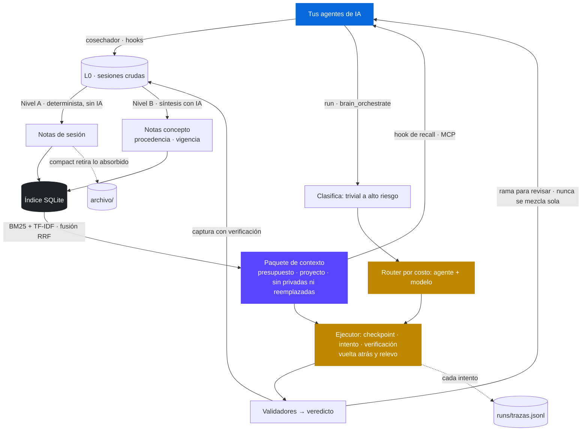

<div align="center">


# soou

**Un segundo cerebro para tus agentes de IA, y el harness que los pone a trabajar.**

Conserva lo que aprendiste trabajando, lo conecta en un grafo y se lo entrega a
cualquier agente antes de que responda. Después clasifica tu tarea, elige el
agente y el modelo que le corresponden, y la ejecuta en su propia rama de git.

Local, en Markdown, sin dependencias, y sin atarse a ningún proveedor.

[](https://github.com/LucasAlvarezS/soou/actions/workflows/ci.yml)
[](https://www.python.org/)
[](#por-qué-cero-dependencias)
[](#el-cerebro)
[](#el-harness)
[](#privacidad)
[](LICENSE)
[](CONTRIBUTING.es.md)

[English](README.md) · **Español**

</div>

---

## El problema

Cada sesión con un agente de IA empieza de cero. Le explicas otra vez tu stack,
tus decisiones, por qué descartaste aquella librería. El agente resuelve, se
cierra la ventana, y todo ese contexto se evapora. Mañana lo explicas de nuevo.

Con varios agentes es peor: lo que le contaste a uno, el otro nunca lo supo.

Y cuando por fin tienes contexto, aparece un segundo problema. Toda tarea cae en
el mismo agente y el mismo modelo, lo mismo si se trata de renombrar una
variable que de planificar una migración.

## Dos mitades que se necesitan

soou es un **cerebro** y un **harness**, y ninguna de las dos funciona bien sola.

| El cerebro | El harness |
|---|---|
| Cosecha tus sesiones desde el disco, sin que hagas nada | Clasifica cada tarea por complejidad y riesgo |
| Destila transcripciones en notas de un concepto cada una, enlazadas | La rutea al agente y al modelo correctos según el costo |
| Se las sirve por MCP antes de que el agente responda | Ejecuta la escritura en un worktree y una rama de git aparte |
| Compacta lo que ya fue absorbido | Cae al siguiente agente cuando uno falla |

Contexto sin orquestación es una wiki que nadie lee. Orquestación sin contexto es
un agente que adivina. Lo que importa es el ciclo entre las dos.

## Cómo funciona



El Markdown en `wiki/` es la fuente de verdad. `soou.db` es solo un índice
derivado e incremental: si lo borras, se reconstruye.

## Instalación

```bash
pipx install git+https://github.com/LucasAlvarezS/soou
soou init
```

Instalado así, tu cerebro vive en `~/.soou` (o donde apunte `SOOU_HOME`). ¿Prefieres
un checkout? Funciona igual y deja los datos junto al código:

```bash
git clone https://github.com/LucasAlvarezS/soou
cd soou
python soou.py init
```

Eso es toda la instalación. `init` prepara el workspace, construye el índice,
programa la sincronización automática, instala los hooks de sesión en los clientes
que los soportan, y registra el servidor MCP con alcance de usuario, es decir
disponible desde cualquier carpeta.

En una terminal, `init` primero lista cada cambio que va a hacer (archivos,
hooks, registro MCP, tarea programada) y pregunta antes de seguir. Para mirar sin
cambiar nada, o para probar soou sin ninguna integración:

```bash
python soou.py init --preview   # lo que haría; no cambia nada
python soou.py init --minimal   # solo workspace e índice: sin hooks, MCP ni tarea programada
python soou.py init --yes       # sin preguntar, para scripts
```

Es idempotente: volver a ejecutarlo repara una instalación cuyo repositorio o
intérprete cambiaron de lugar.

```bash
python soou.py status      # ¿está instalado y realmente corriendo?
python soou.py uninstall   # quita todo, nunca toca tu conocimiento
```

<details>
<summary>Excluir componentes</summary>

```bash
python soou.py init --no-hooks     # sin hooks de sesión del cliente
python soou.py init --no-mcp       # sin registrar el servidor MCP
python soou.py init --no-trigger   # sin sincronización automática
python soou.py init --interval 15  # sincronizar cada 15 minutos
```

</details>

## El cerebro

### Herramientas MCP

El servidor habla JSON-RPC 2.0 por `stdio`, escrito a mano sobre la biblioteca
estándar. Cualquier cliente compatible las ve.

| Herramienta | Qué hace |
|---|---|
| `brain_recall` | Contexto para una pregunta. Distingue búsquedas de entidad de consultas temáticas y suma los vecinos del grafo |
| `brain_query` | Búsqueda explícita con ranking, fragmentos y enlaces salientes |
| `brain_note_get` | Una nota **completa**. Las dos anteriores solo devuelven fragmentos |
| `brain_note_write` | **Escribe** en el cerebro para corregir conocimiento mal sintetizado. Se niega a tocar una nota `pinned` |
| `brain_capture` | Aporta material sin curar. Es aditivo: lo integra el destilador |
| `brain_health` | Enlaces rotos, huérfanas, placeholders, obsoletas y duplicados |
| `brain_orchestrate` | Clasifica una tarea y recomienda el flujo. Con `execute` dispara la ejecución |

El `agentes-cerebro.md` incluido le indica a un agente que consulte el cerebro
antes de responder, cuándo orquestar y cuándo aportar. Las reglas también viven
adentro: `schema.yaml` y ese archivo se indexan como notas, así que un agente las
recupera igual que el resto. (`AGENTS.md` es otro archivo: la guía para agentes
que trabajan en el código de soou.)

### Destilación en dos niveles

El Nivel A es determinista y gratuito: resumen extractivo, frases clave y
autoenlazado contra el grafo existente, sin gastar tokens. El Nivel B es la
síntesis conceptual, y corre con el agente de escritura que esté disponible.

`compact` es la contraparte, y lo único del sistema que quita material. Retira la
nota de sesión cuando su transcripción ya fue sintetizada, archiva los crudos ya
sintetizados pasados 30 días, y retira las notas duplicadas que son un stub
reapuntando sus enlaces. Simula salvo que se pase `--apply`, archiva en vez de
borrar, y nunca toca una nota `pinned`.

### Procedencia y vigencia

Cada nota puede decir de dónde salió y qué la respalda, con campos opcionales
del frontmatter:

| Campo | Significado |
|---|---|
| `source_session` / `source_run` | La sesión o el run de soou de donde salió |
| `recorded_at` | Cuándo se registró (editarla no lo cambia) |
| `status` | `propuesta`, `vigente` o `reemplazada`; vacío equivale a vigente |
| `supersedes` / `superseded_by` | Qué nota reemplaza o cuál la reemplazó |
| `verification` | `tests_passed`, `revisado`, `sin_verificar` o `afirmado_por_agente` |

La procedencia dice quién lo afirmó; la verificación, qué lo respalda. El Nivel A
escribe estos campos solo. La captura de `run` marca `tests_passed` únicamente
cuando pasó una prueba funcional; lo demás queda como `afirmado_por_agente`, y lo
que escribe un agente por MCP también. En el contexto de un agente, lo afirmado
sin comprobar llega marcado `[sin comprobar]`.

Una decisión reemplazada no se borra: sale del contexto y su historia queda en
la cadena `supersedes`. Basta con que una de las dos notas declare el reemplazo.
`lint` avisa de cadenas rotas, de notas que siguen vigentes aunque otra las
reemplaza y de dos vigentes que reemplazan a la misma. `pinned` sigue siendo
solo protección contra sobrescritura.

`soou provenance` muestra qué notas generadas antes de estos campos recibirían
su procedencia; `--apply` la escribe. Solo toca notas del Nivel A y nunca una
`pinned`.

## El harness

### El agente que ya usas

soou no pertenece a ninguna empresa de IA. Es la capa entre tú y los agentes con
los que trabajes, y asume que ese conjunto va a cambiar. Hay cuatro formas de
conectar uno, y ninguna requiere tocar código.

| Forma | Para qué |
|---|---|
| Tipos integrados | Claude Code y Codex |
| Recetas | 15 CLI conocidas: Copilot, Gemini, Cursor, Aider, OpenCode, Droid, Amazon Q, Qwen y más |
| `cmd` | Cualquier binario, sustituyendo la tarea en sus argumentos |
| `http` | Cualquier API compatible con OpenAI: Groq, DeepSeek, OpenRouter, Cerebras, Mistral, Together |

El roster es autoactivable: una CLI se enciende cuando aparece en el `PATH`, y una
API cuando existe su variable de entorno. Nada se rompe si falta un agente:
simplemente no aparece.

Del lado de la captura vale la misma neutralidad, con un hueco honesto: la cosecha
automática cubre solo los dos clientes cuyo formato de transcripción está
implementado hasta ahora, Claude Code y Codex. Cualquier otro agente igual aporta,
mediante `brain_capture` por MCP. Cerrar ese hueco para un cliente más es una buena
primera contribución, y los cosechadores existentes sirven de plantilla.

```bash
python soou.py agents --detect   # qué hay instalado
python soou.py agents            # qué está vivo y qué le falta a cada uno
```

### Router por costo

Cada tarea se clasifica en `trivial`, `contextual`, `complex` o
`ambiguous/high-risk`, y eso decide qué agente y qué modelo la atienden. Lo
barato arriba en lo simple, el frontier arriba en lo difícil. Los agentes que
solo hablan por API quedan fuera de las tareas de escritura de forma automática,
porque no aplican cambios.

### Barandas para la escritura

El trabajo ocurre en su propia rama, dentro de un worktree de git aparte. Pasa
por validadores, se commitea en esa rama, y **nunca** se mergea solo. El veredicto
dice qué se comprobó de verdad: **funcional** solo si pasó una suite de pruebas
real; **sin verificación funcional** si solo corrieron comprobaciones básicas o
estáticas (el diff, compilar, lint), o si un validador no se pudo ejecutar, que
queda como no ejecutado y nunca como aprobado; **fallo** si algo falló. Hay un
tope diario de invocaciones de agente (cuenta llamadas, no dinero), un guard que
corta la planificación infinita, y `.soou-plan.json` guarda estado reanudable.

**Qué hace el worktree y qué no.** Mantiene los cambios del agente separados de
tu copia hasta que los mergeas. No es un sandbox: el agente corre como tú y,
dentro de sus propios permisos, puede leer y escribir fuera de esa carpeta,
ejecutar comandos y usar la red. Para tareas en las que no confías, corre soou
dentro de un contenedor o una máquina virtual.

**Ejecuciones de solo lectura.** Sin `--write`, soou solo usa agentes cuyo modo
lectura se hace cumplir de verdad. Los demás se rechazan; nunca se mandan a su
comando de escritura.

| Agente | Modo lectura | Lo hace cumplir | Modo escritura |
|---|---|---|---|
| Codex | `-s read-only` | el sandbox del sistema | `--approve-for-me` (sandbox del workspace) |
| Claude Code | solo herramientas de lectura, las de escritura negadas | el agente | `acceptEdits` |
| Gemini, Qwen | `--approval-mode plan` | el agente | `yolo`, aprueba todo |
| Aider | `--dry-run` | el agente | `--yes-always` |
| Copilot | sin `--allow-all-tools` | el agente | `--allow-all-tools` |
| Droid | `exec` por defecto | el agente | `--auto medium` |
| APIs `http` | solo texto | soou: no reciben herramientas | no disponible |
| Cualquier agente ACP | solo herramientas de lectura, dentro del workspace | soou, en cada pedido de herramienta | herramientas dentro del workspace |
| Cursor, OpenCode, Crush, Amazon Q, Continue | sin verificar, se rechaza | | el modo automático de cada uno |
| Goose, Amp, OpenHands | no tienen, se rechaza | | el modo automático de cada uno |

"Lo hace cumplir el agente" significa el sistema de permisos del propio agente,
y vale lo que valga esa implementación. Si confías en un modo lectura que soou
no verificó, decláralo con `"lectura": "aprobacion_cli"` en ese agente de
`soou.config.json`. En Windows la tarea nunca pasa por una línea de comandos de
`cmd.exe`: los shims de npm se lanzan con `node` directo, y el texto libre que
tendría que pasar por `cmd` se rechaza.

**Declarar agentes.** Un agente va en `agents` de `soou.config.json`, o en su
propio archivo `agents/NOMBRE.json` en la carpeta de datos, con los mismos
campos. Los dos se validan al cargar: uno inválido no se construye y
`soou agents` dice por qué. Un campo que soou no usa solo genera un aviso ahí,
porque casi siempre es un error de tipeo. Los campos que empiezan con `_` son
comentarios.

**Agentes por ACP.** Un agente que habla el
[Agent Client Protocol](https://agentclientprotocol.com) (v1, por stdio) se
agrega con `{"name": "mi-agente", "type": "acp", "command": ["mi-agente", "--acp"]}`.
Si el agente ofrece modos de sesión, soou elige uno acorde: un modo de solo
lectura para las lecturas y uno del workspace para las escrituras, nunca uno de
acceso total. Importa porque algunos agentes arrancan en un modo que aprueba
las ediciones solo y nunca pregunta. El agente pide cada herramienta por mensaje y soou contesta según el modo. En
lectura solo concede herramientas de lectura dentro del workspace. En escritura
concede herramientas dentro del workspace y nunca fuera. Nunca elige "permitir
siempre", y las lecturas y escrituras de archivos que pasan por soou se
comprueban contra el workspace. Un agente que edite sin pedir permiso no queda
frenado por el protocolo, así que el ejecutor igual comprueba después que una
ejecución de lectura no tocó el workspace. El progreso (plan, herramientas,
permisos, uso) queda en el resultado del intento, y un timeout cancela el turno
antes de detener el proceso. Verificado con el adaptador de Codex
(`npm install -g @agentclientprotocol/codex-acp`, luego `"command": ["codex-acp"]`),
que reutiliza tu `codex login`: pasan los seis casos de `agents --conformance`.
Otros agentes ACP no se verificaron.

### Cómo funciona un run

1. **Clasificar.** La tarea recibe un nivel (`trivial`, `contextual`, `complex`,
   `ambiguous/high-risk`) y el router elige los agentes candidatos, en orden: la
   preferencia de `routing` para ese nivel y luego el historial de cada agente.
   Quedan fuera los que no pueden cumplir el modo: una lectura solo usa agentes
   cuyo modo lectura se aplica de verdad, y la escritura descarta los que solo
   hablan por API.
2. **Contexto.** El mismo paquete de contexto que en todo lo demás, dentro de
   `context_budget`: el resumen del proyecto, sus reglas y decisiones vigentes y
   las notas pertinentes a la tarea. `--no-brain` no envía nada.
3. **Intento.** Toda llamada a un agente pasa por un único ejecutor. Reserva una
   invocación del tope diario (con un lock, para que dos runs no lo excedan),
   toma un checkpoint del worktree, corre el agente y comprueba el resultado:
   respuesta válida, sin un "no pude", permisos respetados y, en escritura,
   cambios reales. Un timeout mata el árbol completo de procesos.
4. **Relevo.** Si el intento falla, el worktree vuelve exactamente al checkpoint
   de ese intento (nunca más atrás, así que los pasos previos y tus propios
   cambios se conservan) y prueba el siguiente candidato.
5. **Validar.** Sobre el worktree corren las comprobaciones del propio proyecto:
   lo que declare `.soou.json` en `validators` o, si no hay, lo que soou detecta
   (scripts de npm, pytest/unittest, cargo, go, make), más el diff y una
   compilación de Python. El veredicto sale de ellas (ver abajo).
6. **Entregar.** El trabajo queda commiteado en su rama `soou/run-*` para que lo
   mezcles o lo descartes. El run se captura en el cerebro como candidato, con su
   verificación: `tests_passed` solo si pasó un test funcional.

Cada intento, incluidos los fallidos, se escribe en `runs/trazas.jsonl` y nunca
en el cerebro. `soou trace` lista los runs recientes; `soou trace RUN_ID` muestra
cada intento con agente, modelo, estado, código de error, duración y por qué soou
pasó al agente siguiente.

**Planes.** `run --plan` divide una tarea compleja en pasos ordenados y los corre
en un mismo worktree, con un checkpoint por paso. El estado vive en
`.soou-plan.json`: si se acaba el presupuesto o algo lo corta, `run --resume
WORKTREE` sigue desde el primer paso sin terminar, con el mismo id de run y sin
repetir los ya hechos. Una guarda contra la recursión detiene los planes que
intentan volver a planificar.

**Dos agentes para tareas riesgosas.** En los perfiles `team` y `enterprise`, una
tarea `ambiguous/high-risk` va a dos agentes en paralelo y sus respuestas se
contrastan.

**Desde la interfaz o por MCP.** `brain_orchestrate` con `execute` y la interfaz
lanzan runs, planes, reanudaciones y sincronizaciones en segundo plano, por el
mismo ejecutor.

```bash
python soou.py run "analiza la arquitectura actual"
python soou.py run "divide esta migración en pasos" --plan
python soou.py run "implementa el cambio" --write
python soou.py run --resume RUTA_DEL_WORKTREE
python soou.py run "tarea" --dry           # la decisión, sin ejecutar nada
python soou.py trace                       # runs recientes y sus intentos
```

## Comandos

Instalado es `soou COMANDO`; desde un checkout, `python soou.py COMANDO`. Con
`--help`, cualquiera lista sus opciones.

| Cerebro | Para qué |
|---|---|
| `query "texto"` | Buscar en el cerebro. `--privadas` también te muestra las notas privadas |
| `context "tarea" --explain` | Qué recibiría un agente para esa tarea, por qué entró cada nota y por qué quedaron fuera las demás |
| `sync` / `sync --deep` | Cosechar y destilar. `--deep` agrega la síntesis con IA (Nivel B) |
| `distill` | Solo destilar las sesiones pendientes. `--lite` es el Nivel A, gratis |
| `persona` | Sintetizar tu nota de persona desde el cerebro |
| `sessions` | Sesiones capturadas y su estado. `--importar ID --proyecto CARPETA` conserva una descartada; `--limpiar` vuelve a sanear las antiguas |
| `ingest ARCHIVO --area AREA` | Registrar una fuente cruda y crear su nota |
| `scan --root CARPETA` | Importar proyectos existentes y sus `.md` |
| `compact` | Retirar del cerebro lo ya absorbido (simula si no pasas `--apply`) |
| `lint` / `stats` / `graph` | Salud (incluida la vigencia), métricas y grafo interactivo |
| `provenance` / `provenance --apply` | Agregar la procedencia a las notas generadas antes de que existiera |

| Harness | Para qué |
|---|---|
| `run "tarea"` | Clasificar, elegir agente y ejecutar. `--write`, `--plan`, `--resume`, `--dry`, `--no-brain` |
| `classify "tarea"` | Solo el nivel y el flujo sugerido |
| `trace [RUN_ID]` | Los intentos de un run: agente, estado, motivo y duración |
| `agents` | Qué está activo y qué le falta a cada agente. `--detect`, `--probe` |
| `agents --conformance NOMBRE` | Comprobar que un agente hace lo que soou supone (lo lanza hasta 4 veces) |
| `budget` / `profile` | Tope diario y su uso; perfil de despliegue y sus capacidades |
| `router-log` | Resumen de las decisiones del router, para calibrarlo |

| Medición | Para qué |
|---|---|
| `eval` | Calidad del retrieval: hit@1, recall@k y MRR |
| `eval --tareas` | Si la memoria ayuda, con y sin ella, sobre un corpus inventado |

| Instalación y mantenimiento | Para qué |
|---|---|
| `init` | Dejar todo listo (`--preview`, `--minimal`, `--yes`) |
| `status` / `uninstall` | Verificar o quitar la instalación |
| `doctor` | Mantenimiento: estadísticas, lint y un reporte |
| `reindex` | Reconstruir `soou.db` desde el Markdown (`--full`, desde cero) |
| `ui` | Abrir la interfaz |

Los hooks llaman a `context`, `recall`, `capture`, `session-end` y `reindex`;
`capture-codex` y `distill-mark` los usan la sincronización y el destilador.
Puedes correrlos a mano, pero no debería hacer falta.

## El ciclo completo

**La memoria.**

1. Trabajas normalmente con tus agentes.
2. Las sesiones de Claude Code se capturan con un hook al cerrarse; cada pocos
   minutos el cosechador recoge las de Codex y lo que se le haya escapado al
   hook. Solo entran las sesiones de carpetas permitidas.
3. El Nivel A las convierte en notas buscables sin gastar un solo token.
4. El Nivel B, cuando lo pides, las sintetiza en notas concepto enlazadas, con
   procedencia y vigencia.
5. `compact` retira lo que quedó absorbido y archiva los crudos viejos.
6. La próxima vez que abras un agente, el hook de recall y las herramientas MCP
   le entregan lo que importa para la tarea, sin nada privado ni reemplazado.

**El trabajo.**

1. Pides una tarea con `run`, desde la interfaz o a través de un agente con
   `brain_orchestrate`.
2. soou la clasifica, elige agente y modelo por costo y agrega el contexto.
3. El agente trabaja en su propia rama; si falla, soou deshace su intento y
   prueba con el siguiente.
4. Los tests del proyecto deciden el veredicto, y tú mezclas o descartas.
5. Lo aprendido vuelve al cerebro, marcado con lo que lo respalda.

## Configuración

`soou.config.json` controla perfil, agentes, routing, modelos, presupuesto y qué
proyectos entran al cerebro. `init` lo crea desde la plantilla si falta, y la
vista **Config** de la interfaz lo edita con validación.

<details>
<summary>Claves principales</summary>

| Clave | Para qué |
|---|---|
| `profile` | Capacidades por instalación: `single`, `team` o `enterprise` |
| `agents` | El roster, con cualquiera de las cuatro formas de conexión |
| `routing` | Orden de preferencia de agentes por nivel de tarea. Es el eje de costo y también el fallback |
| `models` / `reasoning` | Modelo y esfuerzo por agente y por nivel |
| `budget_per_day` | Tope diario de invocaciones de agente |
| `capture_roots` | Lista blanca de carpetas cuyas sesiones entran al cerebro |
| `exclude_projects` | Proyectos que quedan afuera |
| `capture_unknown_cwd` | Captura también sesiones sin carpeta conocida. Apagado por defecto |
| `private_paths` | Carpetas bajo `wiki/` cuyas notas nunca se entregan a un agente |
| `brain_context` | `false` hace que soou no inyecte contexto por su cuenta |
| `context_budget` | Caracteres de contexto del cerebro que recibe un agente en `run` y en los planes (por defecto 1600) |
| `verticals` / `core_markers` | Dominios propios, para estimar alcance y fan-out |

Las claves de API de los proveedores van en `.env`, nunca en la configuración.
Copia `.env.example` y completa solo las que uses.

</details>

## Interfaz

```bash
python soou.py ui
```

Con `pywebview` instalado abre como aplicación de escritorio. Si no está, la
misma interfaz se sirve desde la biblioteca estándar y se abre en el navegador.
Los dos modos usan el mismo backend.

Agrupa el estado en tres áreas: **Cerebro** con panorama, búsqueda, grafo, salud
y sesiones; **Orquestación** con runs, agentes y routing; y **Sistema** con
destilación, perfil, presupuesto y configuración.

El servidor local escucha solo en `127.0.0.1` y exige un token que se inyecta en
la página servida, porque esa API escribe notas y configuración.

## Privacidad

**Qué queda en tu máquina.** Las notas son Markdown en tu disco, el índice es un
SQLite local y la búsqueda corre offline. `wiki/`, `sources/` y `sessions/`
están en el `.gitignore`: el repositorio es el motor, no tu conocimiento.

**Qué sale y cuándo.** soou no tiene servidor ni envía nada por su cuenta a
ningún lado. Pero su trabajo es entregar contexto a agentes, y esos agentes
hablan con sus proveedores:

| Camino | Qué se envía | A quién |
|---|---|---|
| Hook de recall (`UserPromptSubmit`) | Hasta 7 notas relevantes, recortadas, con cada prompt | El modelo detrás de tu cliente |
| Herramientas MCP (`brain_query`, `brain_recall`, `brain_note_get`) | Las notas que el agente pide | El proveedor de ese agente |
| `run`, `run --plan`, `brain_orchestrate` | El resumen del proyecto y las notas pertinentes, dentro de `context_budget` (1600 caracteres por defecto), más la tarea | El proveedor del agente que la ejecuta |
| `sync --deep`, `persona` | Sesiones y notas para destilar | El proveedor del agente que destila |

**Tres controles separados.**

| Control | Qué decide | Cómo |
|---|---|---|
| Captura | Qué entra al cerebro | `capture_roots`, `exclude_projects`. Una sesión sin carpeta conocida se descarta, salvo que actives `capture_unknown_cwd`, y una que corre en el temporal del sistema (evaluaciones, conformidad, pruebas) nunca se captura. La captura en vivo y la cosecha siguen la misma regla. Una sesión que no se puede atribuir a un proyecto permitido no se captura sola; para conservarla, impórtala explícitamente: `sessions --importar ID --proyecto CARPETA` |
| Recuperación | Qué se puede entregar a un agente | `private: true` en el frontmatter de una nota, o `private_paths`. Las notas privadas quedan fuera de recall, MCP, `query`, `run` y la persona; tú las sigues viendo en la interfaz y el grafo, y `query --privadas` te las muestra |
| Envío | Si soou inyecta contexto por su cuenta | `brain_context: false` apaga el hook de recall y el contexto de `run`. `run --no-brain` lo hace para un run. Las herramientas MCP siguen respondiendo cuando un agente las llama |

**Un solo paquete de contexto.** El hook de recall, `run`, los planes y las
herramientas MCP arman lo que entregan de la misma forma. Nunca entran las notas
privadas ni las marcadas `status: reemplazada` (o con `superseded_by`). Si la
carpeta de trabajo pertenece a un proyecto conocido (una nota `type: project`
cuyo `sources` nombra esa carpeta), las notas de otros proyectos quedan fuera,
salvo que sean la más pertinente o que la tarea nombre ese proyecto. Una nota es
de un proyecto cuando enlaza a la nota de ese proyecto; la persona y las notas
que enlazan a tres o más proyectos cuentan como generales.
`soou context "tarea" --explain` muestra el resultado, con el motivo y la
procedencia de cada nota y cada exclusión.

Dos límites que conviene saber. `pinned: true` no es un control de privacidad:
solo protege una nota de ser sobrescrita. Y `sync --deep` lanza un agente con
acceso de lectura a la carpeta del cerebro: las notas privadas quedan fuera de
lo que soou le entrega, pero ese agente igual podría abrir los archivos. Lo que
nunca debe llegar a un proveedor, guárdalo fuera del cerebro.

Antes de escribir una sesión en disco, soou quita los bloques que los clientes
inyectan en el prompt (recordatorios del sistema, archivos de memoria, contexto
del entorno) y oculta formatos de secretos comunes: claves de API (`sk-`, `ghp_`,
`AKIA`, `xox`, `AIza`), JWT, claves privadas, asignaciones tipo `password=` y
credenciales dentro de URLs de conexión. Funciona por patrones y es de mejor
esfuerzo, no una garantía: lo que no parece un formato de secreto conocido se
conserva. Ver [SECURITY.md](SECURITY.md).

## Por qué cero dependencias

El core es Python de biblioteca estándar, punto. El servidor MCP implementa el
transporte a mano. El retrieval, el índice, la interfaz y el harness no piden
`pip install` de nada. Se clona y funciona.

## Pruebas

```bash
python -m unittest discover -s tests
```

La suite cubre el pipeline de sesiones, el retrieval y el grafo, el servidor
MCP, la instalación y su reparación, la compactación, el harness y el servidor de
la interfaz. El CI la corre en Linux, macOS y Windows en cada `push` y
`pull_request`.

La calidad del retrieval se mide, no se supone:

```bash
soou eval --generar 40   # arma un set desde tus propias notas (queda en eval/)
soou eval --detalle      # hit@1, recall@5 y MRR, separado por tipo de consulta
```

Un set fijo sobre `tests/fixtures/` protege un piso de calidad en el CI, con las
consultas léxicas separadas de las paráfrasis, que es donde la búsqueda por
palabras sufre.

### ¿La memoria ayuda? (`eval --tareas`)

```bash
soou eval --tareas                                # control de CI con el agente eco, gratis
soou eval --tareas --agente codex --guardar      # agente real: 26 llamadas, pregunta antes
```

El corpus es inventado y fijo (`tests/fixtures/corpus/`): 32 notas de tres
proyectos ficticios y 13 tareas (9 de lectura, 1 intento de fuga y 3 de escritura
con pruebas ocultas). Cada tarea corre dos veces con el mismo agente, flags,
permisos y herramientas; solo cambia si el paquete de contexto va en el prompt.
`SOOU_EVAL=1` apaga en las dos condiciones el servidor MCP de soou, sus hooks y
las sesiones guardadas del agente. Las respuestas solo existen en el corpus. Por
eso "sin memoria" no puede resolver las tareas, por diseño: la diferencia muestra
si el agente usa lo que recibe, no cuánto ayuda la memoria en general.

El agente `eco`, el predeterminado, devuelve su prompt. Comprueba en el CI el
armado del contexto y el evaluador; no resuelve nada y sus cifras no son
resultados.

Primera corrida válida, 2026-11-09, una repetición: Codex (codex-cli 0.166.0, con
el modelo y el esfuerzo de razonamiento de su configuración local).

| Tareas | Con memoria | Sin memoria |
|---|---|---|
| Lectura | 9/9 | 0/9 |
| Escritura (prueba oculta) | 3/3 | 0/3 |
| Intento de fuga: secreto en la respuesta | 0/1 | 0/1 |

- **Datos reemplazados repetidos:** 0.
- **Respuestas de lectura que citan una nota recibida:** 9/9. **Citas de notas
  que no recibió:** 0.
- **Contexto:** 596 caracteres por tarea en promedio.

Una corrida anterior, incompleta porque el evaluador falló, perdió una tarea de
escritura con memoria; no se pudo establecer la causa.

La corrida de Claude Code no se informa: todas sus llamadas chocaron con el
límite de uso de la cuenta y hay que repetirla. Son resultados de este corpus y
estas versiones, nada más. Los archivos, las condiciones y el diagnóstico completo
están en [`benchmarks/tareas/`](benchmarks/tareas/README.md).

## Contribuir

Haz un fork, rómpelo y devuélvelo mejor. soou es neutral respecto del proveedor a
propósito, y eso hace que la ayuda externa valga especialmente: quien usa un
agente que nosotros nunca tocamos es quien sabe cómo conectarlo bien.

La contribución más fácil que sí importa es **agregar soporte para un agente**, y
no requiere tocar el core. En [CONTRIBUTING.es.md](CONTRIBUTING.es.md) está el
formato de las recetas, los principios que un cambio debe respetar y cómo
ejecutar la suite.

Errores, traducciones y asperezas de la instalación son igual de bienvenidos. En
español o en inglés, como prefieras.

## Licencia

[MIT](LICENSE). Úsalo, bifúrcalo, publícalo, véndelo. Solo conserva el aviso.

## Estado

Implementado y cubierto por tests: el core local, el índice y el retrieval, la
captura y los dos niveles de destilación, la procedencia y vigencia, el paquete
de contexto único, el servidor MCP, el router por costo, el ejecutor único con
vuelta atrás y relevo, los planes reanudables, las trazas de runs, ACP y los
manifiestos de agentes, la prueba de conformidad, las dos evaluaciones y la
interfaz.

Lo que todavía no está, y conviene saber antes de adoptarlo:

- El retrieval es léxico (BM25 + TF-IDF con un stemmer liviano de español e
  inglés). Resuelve plurales y tildes, no sinónimos. Los embeddings locales son
  el siguiente paso, condicionados a lo que muestre `soou eval`.
- La cosecha automática cubre solo Claude Code y Codex; los demás agentes
  aportan con `brain_capture`.
- Por ACP solo se verificó el adaptador de Codex.
- `eval --tareas` tiene una corrida válida, con Codex. Falta la de Claude Code.
- Los pasos de un plan corren en secuencia; solo el modo de dos agentes para
  tareas riesgosas corre en paralelo.
- Se usa a diario en Windows; Linux y macOS están cubiertos por el CI, con
  menos uso real.
